

**Vitrine dos sistemas que desenvolvi como Desenvolvedor Full Stack na Health & Safety**

O código é privado (propriedade da empresa). Aqui estão as telas, o que cada sistema faz e a stack usada. ⚠️ Todas as telas usam <b>dados fictícios</b>.

 

---

## 📑 Sistemas

| Sistema | O que é | Destaque |
|---|---|---|
| [🎫 HelpHS](#-helphs--help-desk-para-clientes) | Help Desk para clientes externos | Substituiu o atendimento via WhatsApp |
| [🧠 TalentHS](#-talenths--plataforma-de-rh-com-ia) | Plataforma de RH com psicometria e IA | DISC/OCEAN, 9Box e chat com IA |
| [🏷️ ControlHS](#️-controlhs--gestão-de-patrimônio) | Gestão de patrimônio | 400+ itens · R$ 200 mil em ativos |
| [📈 GrowthHS](#-growthhs--crm-comercial) | CRM comercial próprio | Substituiu o Pipedrive |
| [🛠️ ChamadosHS](#️-chamadoshs--help-desk-interno) | Help Desk interno de TI | Kanban de chamados com prioridades |

> Desenvolvidos em parceria com **Erick Santos**: eu à frente do front-end e atuando junto com ele no back-end (APIs em FastAPI e modelagem PostgreSQL), do desenho da solução ao deploy.

---

## 🎫 HelpHS — Help Desk para clientes

Os clientes externos abriam chamados pelo WhatsApp, sem controle, SLA ou histórico. O HelpHS virou a plataforma oficial de suporte.

- Kanban de tickets com status em tempo real
- SLA automático por prioridade, com alertas de vencimento
- Dashboard com CSAT, tempo médio de resolução e conformidade de SLA
- Base de conhecimento, perfis de acesso (Admin, Técnico, Usuário) e audit log

**Stack:** React · TypeScript · Tailwind · Python · FastAPI · PostgreSQL · Docker · Easypanel

<table>
  <tr>
    <td>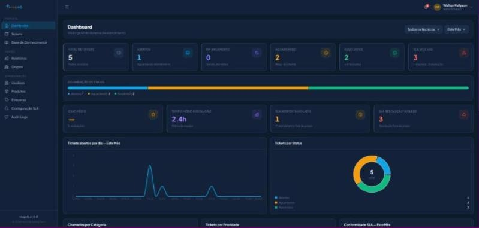 Dashboard</td>
    <td>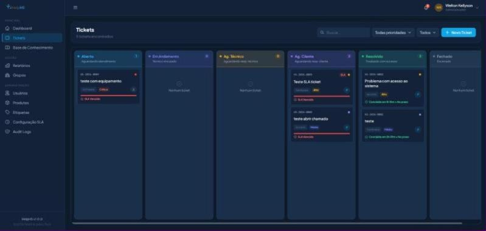 Kanban de tickets</td>
  </tr>
  <tr>
    <td colspan="2">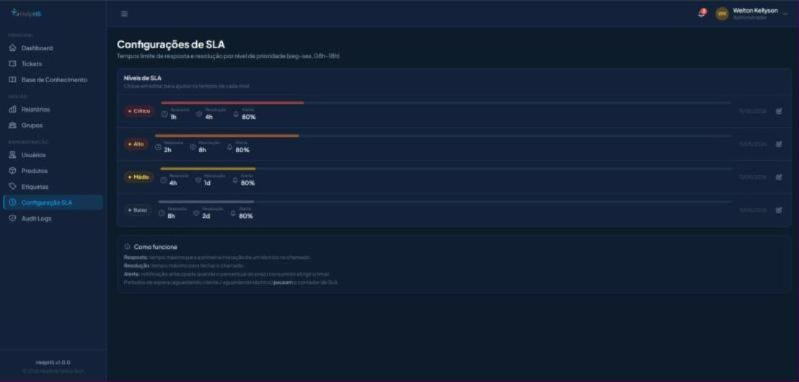 Configuração de SLA por prioridade</td>
  </tr>
</table>

---

## 🧠 TalentHS — Plataforma de RH com IA

O projeto mais complexo que já desenvolvi em termos de produto e UX: gestão de pessoas completa, com psicometria e IA.

- Psicometria DISC + OCEAN por colaborador
- Mapa 9Box para avaliação de desempenho
- Chat com IA personalizado pelo perfil do colaborador
- Dashboard de desenvolvimento individual e análise de equipe
- Calendário corporativo, metas e avaliações

**Stack:** React · TypeScript · Tailwind · Python · FastAPI · PostgreSQL · OpenAI API · Docker

<table>
  <tr>
    <td>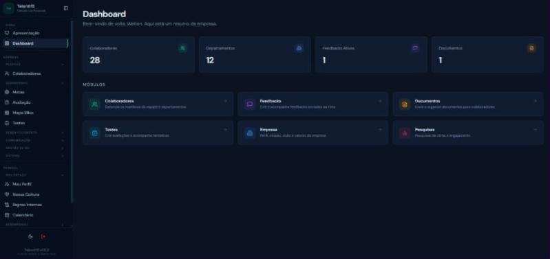 Dashboard do RH</td>
    <td>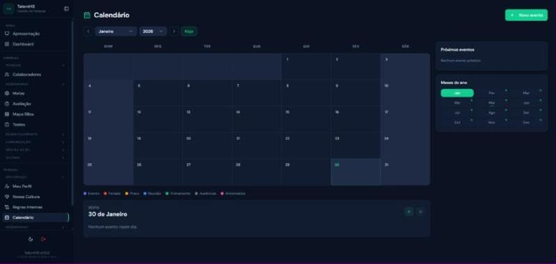 Calendário de eventos</td>
  </tr>
  <tr>
    <td colspan="2">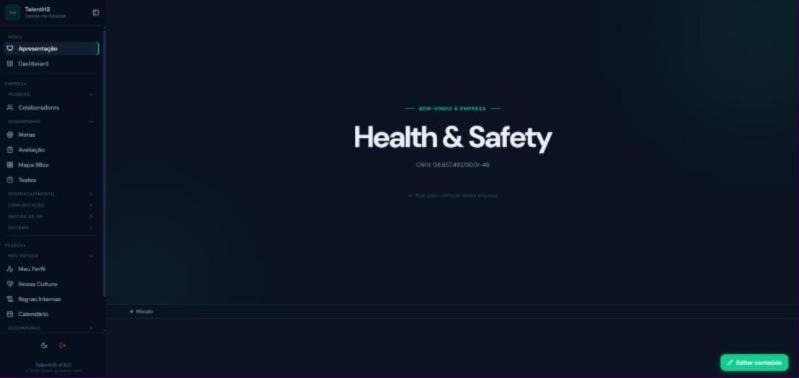 Página de apresentação da empresa</td>
  </tr>
</table>

---

## 🏷️ ControlHS — Gestão de Patrimônio

Controle completo dos ativos da empresa: cadastro, transferências entre setores, baixas, inventário e depreciação.

- Mais de 400 itens e R$ 200 mil em ativos gerenciados
- Transferências com histórico e rastreabilidade
- Baixas com justificativa e cálculo automático de depreciação
- Sessões de inventário, log de auditoria e controle de acesso por perfis

**Stack:** React · TypeScript · Python · FastAPI · PostgreSQL · Docker · Easypanel

<table>
  <tr>
    <td>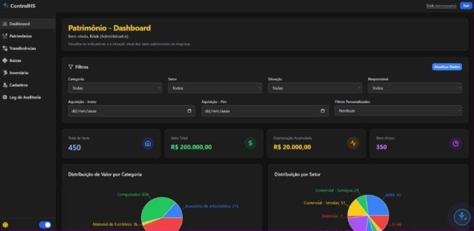 Dashboard de patrimônio</td>
    <td>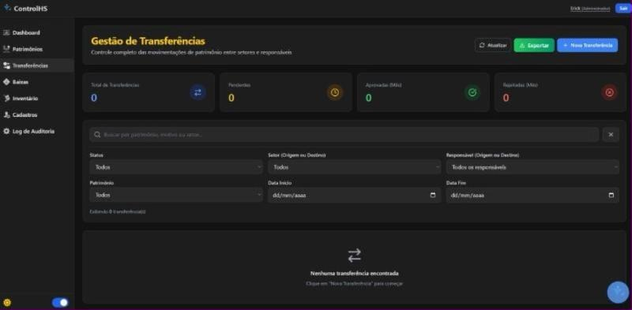 Gestão de transferências</td>
  </tr>
  <tr>
    <td>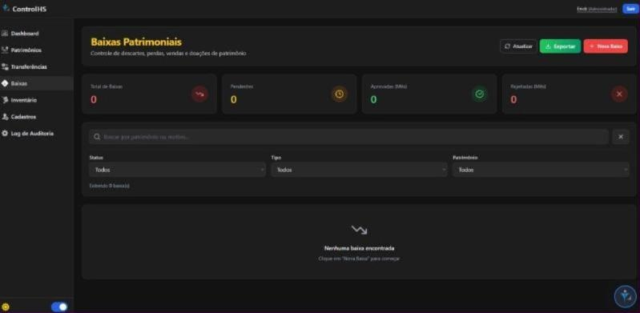 Baixas patrimoniais</td>
    <td>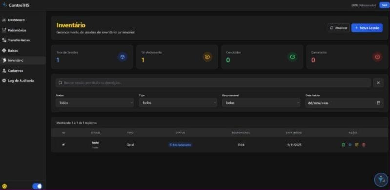 Inventário</td>
  </tr>
</table>

---

## 📈 GrowthHS — CRM Comercial

A assinatura do Pipedrive custava caro e não atendia o fluxo comercial da empresa. Construímos um CRM sob medida.

- Pipeline com boards e cards no formato do time comercial
- Integração com RD Station para ingestão de leads
- Automações configuráveis (atribuição de vendedor/SDR, movimentações)
- Dashboard de SDR e vendedores, com evolução de leads e taxas de conversão

**Stack:** React · TypeScript · Tailwind · Python · FastAPI · PostgreSQL

<table>
  <tr>
    <td>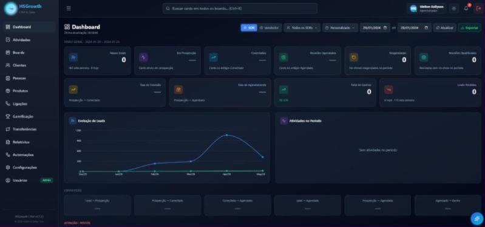 Dashboard comercial</td>
    <td>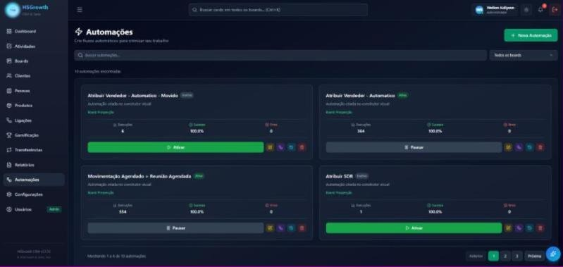 Automações do CRM</td>
  </tr>
</table>

---

## 🛠️ ChamadosHS — Help Desk interno

Os colaboradores abriam chamados de TI pelo WhatsApp. O ChamadosHS organizou o suporte interno.

- Abertura e acompanhamento de chamados
- Kanban por status, categorias e prioridades
- Histórico completo e tempo médio de resolução

**Stack:** React · TypeScript · Python · FastAPI · PostgreSQL

<table>
  <tr>
    <td>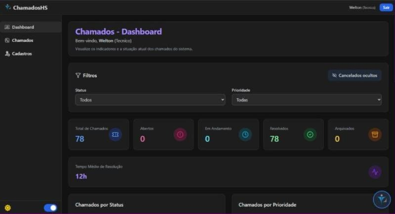 Dashboard</td>
    <td>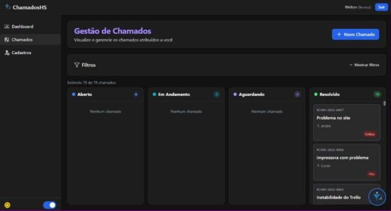 Gestão de chamados</td>
  </tr>
</table>

---

## ⚡ Outros sistemas da suíte

- **DataCoreHS:** dashboards financeiros, de metas e de estoque integrados ao ERP (+40% de eficiência na análise)
- **HealthScore:** treinamento de vendas com IA simulando objeções reais (−30% no tempo de treinamento)
- **AI Recruiter:** triagem de currículos com n8n + OpenAI API (−70% no tempo do processo seletivo)
- **AppHealth:** app mobile em Flutter integrado via Bluetooth aos equipamentos

---

Gostou? Vamos conversar 👇

